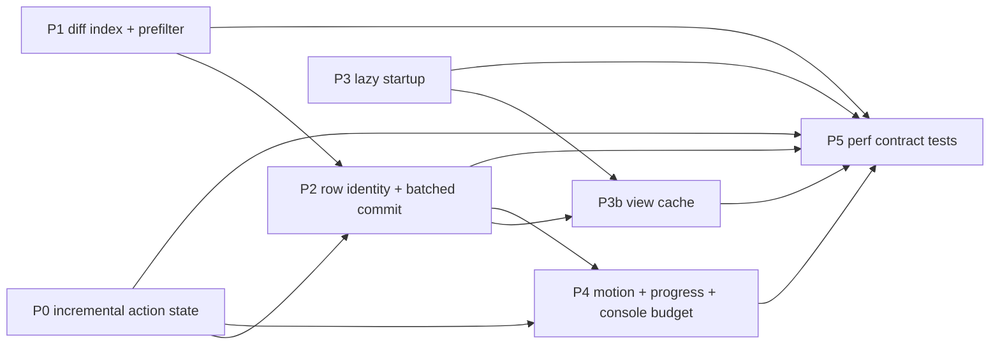

# UI responsiveness & performance plan — yt-sync TUI

Scope: `yt_sync.py` (Textual 8.2.8 app), the interactive path only. Goal: every
keystroke and every operation completion is reflected within one or two frames,
no operation silently blocks or shifts the layout, and motion stays smooth on
local terminals while remaining instant under ssh/tmux.

Baseline measured on this machine (Python 3.14.7, Textual 8.2.8, 140x45 test
harness) with the code as of `HEAD`.

## 1. Baseline measurements

| What | Measured | Method |
|---|---|---|
| `diff()` worst case, 400 playlist × 1500 local, nothing matches | **55.4 s** | direct call, synthetic titles |
| `diff()` worst case, 1000 playlist × 4000 local | **91.5 s** | direct call |
| single `SequenceMatcher(...).ratio()` pair | **51 µs** | 2000 pairs, `time.perf_counter` |
| `_populate_table()` 1000 rows | **17 ms** on the event loop | `run_test` + `_populate_table` |
| `_populate_table()` 3000 rows | **53 ms** on the event loop | same |
| filter switch (rebuild + notify) at 3000 rows | **55 ms** | `action_filter_missing` + `action_filter_all` |
| table insert 1000 / 3000 rows, plain vs `app.batch_update()` | 14 ms / 70 ms vs 18 ms / 46 ms | harness |
| module import (`import yt_sync`, Textual CSS parse) | **195 ms** | `time` around import |
| `require_runtime_dependencies()` (`import yt_dlp`, `mutagen`, `textual`) | **136 ms** | direct call |
| same check via `importlib.util.find_spec` × 3 | **0.65 ms** | direct call |
| console: 500 writes of markup strings vs prebuilt `Text` | 131 ms vs 64 ms | `RichLog.write` on event loop |
| existing suite | 63 passed | `python -m pytest test_yt_sync.py -q` |

## 2. Findings, ranked by user-visible impact

**F1 — every single-row action triggers a full network refresh, already flagged idle.**
`_do_download_single` (L1891), `_do_trash_single` (L1907), `_do_download` (L1943)
and `_do_trash` (L1987) all end with

```python
self._busy = False
self._set_loading(False)
await self._async_load_data()      # fetch_playlist (subprocess, 120 s timeout) + scan + diff
```

So `enter` on one failed track costs a yt-dlp playlist fetch, a full scan, a full
diff and a full table rebuild — after the spinner was switched off and `_busy`
cleared. The window between those two statements and the arrival of fresh data is
an unguarded "looks idle but holds stale state" interval: `d`/`t` act on the old
`diff_result`, so a second `d` re-downloads tracks that already completed
(`--no-overwrites` saves the bytes, not the round trip). The rebuild also resets
the table cursor to row 0, so the row you just acted on jumps away.

**F2 — the fuzzy fallback is O(playlist × local) pure Python.**
`diff()` (L385) recomputes `normalize(f.stem)` inside the inner loop and runs
`SequenceMatcher(None, nt, normalize(f.stem)).ratio()` against every unused local
file for every unmatched playlist entry. 51 µs/pair, 91.5 s at 1000×4000.
`asyncio.to_thread(build_diff, ...)` (L1652) keeps the event loop alive but not
smooth: CPython's GIL means the thread still takes ~half the interpreter time
away from the render loop, so the `LoadingIndicator` stutters and input latency
spikes for the whole diff.

**F3 — the whole table is destroyed and rebuilt on every filter press and refresh.**
`_populate_table()` (L1681) does `table.clear()` then `add_row` per row inside the
event loop: 17 ms at 1k rows, 53 ms at 3k, 55 ms per filter switch. Row keys are
positional strings (`str(key)`), so selection and cursor cannot be preserved by
identity; `action_filter_*` (L1809 ff.) also clears `self.selected` outright.

**F4 — startup pays for an import it does not need.**
`require_runtime_dependencies()` (L61) calls `importlib.import_module` for
`textual`, `yt_dlp` and `mutagen`: 136 ms, 99.5% of it `yt_dlp`, only to prove
the module exists. The TUI never imports it at runtime (yt-dlp is invoked as
`sys.executable -m yt_dlp`). CLI modes (`--diff-only`, `--download-only`,
`--auto`) also import the whole Textual app module and parse its CSS for nothing.

**F5 — the top bar painted on one row; the loader was never a layout shift.**
Measured against Textual 8.2.8's `_arrange.py`: every `dock: top` sibling is
anchored at `Region(0, 0, w, h)` and only `max(height)` is reserved. So the header,
the status bar and the spinner all drew on row 0 — the status text and spinner
overlapped the title — and the table started at row 1. Fixed by docking a single
`#top-bar` (`Vertical`, height 3) that stacks header, status bar and the reserved
`#loader-slot` as flow children; the table now starts at row 3 and the spinner has
its own row. Covered by `test_dashboard_top_rows_do_not_overlap` and
`test_loader_toggle_does_not_move_the_table`.

**F6 — global `j`/`k` leak through modal screens.**
`on_key` (L1772) calls `table.action_cursor_down/up` with no screen or focus guard.
Verified in the harness: with `ConfigurationHomeScreen` open and its `ListView`
focused, `j` moves the dashboard cursor (row 0 → 1) behind the modal. Declarative
app `BINDINGS` do not leak, only this handler does. *(Fixed with the
configuration-home keyboard pass: the ad-hoc `on_key` handler is gone, `j`/`k`/`g`/`G`
are live `App` actions that no-op while a `ModalScreen` is active, and the home
owns `j`/`k` as list navigation. Regression tests:
`test_j_and_k_move_the_saved_configuration_selection`,
`test_g_and_shift_g_jump_to_list_ends`.)*

**F7 — console write amplification.**
`RichLog` is created without `max_lines` (L1556) and gets two markup lines per
downloaded track; the log grows without bound and every write re-parses markup
and re-renders (2× the cost of prebuilt `Text` at 500 writes). `highlight=True`
adds further per-line work for plain progress text that has no syntax.

**F8 — no cancel path, no progress counts, no motion policy.**
A 100-track batch cannot be stopped; the only progress signal is log lines and a
spinner with no `i/n` outside the log; `App.animation_level` /
`TEXTUAL_ANIMATIONS` are never consulted, and no CSS `transition` is used, so the
app cannot adapt motion to slow terminals.

**F10 — a `:hover` style on DataTable froze the loop during mouse travel.**
Measured in a real terminal (tmux, 120×40, 3000 rows): 600 synthetic SGR mouse
moves over the table blocked the event loop for **2311 ms** (~3.9 ms/move);
crossing table/console: 1946 ms. The same flood over a minimal Textual DataTable
cost 146 ms, and the DataTable hover handler itself is ~110 µs/move. Profiling
showed `Screen._handle_mouse_move` → `App._set_mouse_over` →
`Stylesheet.update_nodes` → `Stylesheet.apply` (13,409 applications for 600 moves,
~5 s profiled): because the table had a `:hover` rule, Textual re-applied the
table's stylesheet on every move, and DataTable's component-class matching makes
that expensive. `animations = "none"` did not help (2367 ms); removing CSS
transitions only helped ~30 % (1627 ms). Removing the `DataTable:hover` rule made
the flood cost **147 ms** and dropped `Stylesheet.apply` during table hovers to 0.
Fixed in `YTSyncApp.CSS` (focus keeps the border cue); guarded by
`test_mouse_moves_over_the_table_do_not_restyle_it`, which counts
`Stylesheet.apply` calls per hover and allows at most one table restyle.

**F9 — cold start shows an empty table for the whole network round trip.**
After a configuration is chosen, `_do_refresh` (L1642) fetches the playlist before
any row exists, so the table stays empty for seconds even when the exact same
playlist and folder were rendered minutes ago. Nothing is cached: `diff_result`
lives only in the process, and the startup path re-derives everything from
network + directory scan. Perceived snappiness on launch is dominated by this,
not by per-frame costs.

## 3. Targets

| Interaction | Budget | Current |
|---|---|---|
| `enter` → row shows new status (single download/trash) | ≤ 2 frames after yt-dlp returns, no network call | **landed**: local rescan + diff from cached playlist, cursor row kept |
| refresh, realistic (unmatched set is what pays for fuzzy) | ≤ 0.5 s | **landed**: 0.26 s at 100 unmatched × 1000 local (was 2.3 s) |
| refresh, pathological 1000 playlist × 4000 local, nothing matches | ≤ 1.5 s | **not met**: 10.5 s (was 91.5 s; ~4M comparisons at ~2.6 µs) |
| filter key, 3000 rows | ≤ 50 ms total, no main-thread slice > 32 ms | **landed**: 14 ms caller block at 3000 rows, 25 ms at 8000 (chunked worker); 20 ms at 1000 (single batch) |
| process start → first interactive frame | ≤ 250 ms | **partial**: dependency check 136 ms → 0.4 ms; remaining ~218 ms is the Textual import shared by every mode |
| config chosen → non-empty table (cached rows) | ≤ 250 ms, marked stale | **landed**: `view-cache.json` paints the last view before the network; actions paused until the first refresh |
| loader/spinner toggle | zero layout shift, no dropped row | **landed**: `#top-bar` docks header + status + reserved spinner slot as separate rows (table starts at y=3) |
| any keyboard event during a batch | ≤ 16 ms handler time | input contends with diff GIL |
| `animations = "none"` | no transition repaints, UI still updates instantly | **landed**: `[yt-sync] animations = full\|basic\|none` → `app.animation_level`; invalid values fall back to `full` |

## 4. Phases

### P0 — decouple actions from the refresh pipeline (F1, F5, F8) — *core landed*

Landed:
- `YTSyncApp._playlist` caches the playlist; `_async_load_data(fetch=True)` only
  refetches it for `r`, first load and configuration changes (invalidated when the
  URL changes). All action workers call `_async_load_data(fetch=False)`.
- Single download/trash keep `_busy` and the loader on through the reconcile (the
  old code cleared both, then awaited a network refresh). Covered by
  `test_single_download_reconciles_without_refetching_playlist`.
- Batch workers check `_cancel_requested` between tracks; `escape` requests a stop
  while `_batch_active` (otherwise it clears selection, or notices that a single
  operation is in flight). Covered by
  `test_escape_stops_a_batch_after_the_current_track`.
- `_populate_table` preserves the cursor row and scroll offset across rebuilds
  (`test_refresh_rebuild_keeps_the_cursor_row`).

Remaining:
- In-place row patching (`update_cell_at` / `remove_row`) instead of a full
  reconcile, so a single action costs one cell update rather than a rescan+diff.
- One operation-state object replacing `_busy`/`_batch_active`/`_cancel_requested`,
  with `i/n` progress.
- Reserve the loader slot so `_set_loading` stops reflowing the table.

### P1 — make the diff cheap enough to be synchronous-feeling (F2) — *landed*

Landed in `diff()`:
- Normalized local stems are computed once per call instead of M×N times.
- Two gates that are provable upper bounds on `SequenceMatcher.ratio()`, so they
  cannot change the `> 0.85` outcome: the length bound (`40*min <= 17*sum`, i.e.
  `real_quick_ratio() <= 0.85`) and `quick_ratio() <= 0.85`.
- One `SequenceMatcher` per local file, reused via `set_seq1()`; difflib caches the
  b-side index, which was previously rebuilt for every (playlist, local) pair.

Measured: 400×1500 all-unmatched **55.4 s → 1.44 s**; 1000×4000 **91.5 s → 10.5 s**;
realistic 100 unmatched × 1000 local **≈ 0.26 s**. Guarded by
`DiffPerformanceTests.test_unmatched_diff_stays_within_budget` (100×1000, 2 s cap).

Rejected after measurement:
- A 4-gram inverted index: a pair can exceed 0.85 with no shared 4-gram
  (`"abcdefghijklmnopqrst"` vs `"abcZdefZghiZjklZmnoZpqZrst"`, ratio 0.87, longest
  block 3), so it is unsound; it was also slower on shared-prefix corpora
  (13 s vs 10.5 s at 1000×4000) because music titles share most grams.
- `quick_ratio` removal (ratio-only): 8.3 s vs 1.5 s at 400×1500.

Remaining: the 1000×4000 pathological case is dominated by ~4M unavoidable
comparisons at ~2.6 µs each. If it ever matters, chunk the fuzzy phase with
`await asyncio.sleep(0)` every N titles so the render loop interleaves.

### P2 — commit rows without destroying identity (F3, F6) — *landed*

Landed in `_build_row_model` / `_populate_table` / `_commit_rows`:
- Row keys are `<track id>#<occurrence>` (occurrence counted across the whole
  diff in a fixed category order, so the key for a track does not change when the
  filter changes) and `str(path)` for orphans. Bare `track.id` would raise
  `DuplicateKey` for playlists that list a video twice; covered by
  `test_duplicate_playlist_entries_get_distinct_row_keys`.
- The first column still shows a 1..N display number (`_row_numbers`); the key is
  no longer the visible cell text, so `_refresh_select_marker` uses the number.
- One batch commit (`batch_update`) up to 1000 rows; above that,
  `_commit_rows` inserts 500-row chunks with `await asyncio.sleep(0)` and a
  generation counter that aborts stale commits before they clear the table.
  Measured caller block: 20 ms at 1000 rows, 14 ms at 3000, 25 ms at 8000.
  Covered by `test_large_row_set_commits_without_blocking_the_caller` and
  `test_stale_large_commit_cannot_wipe_a_newer_populate`.
- Cursor is restored by key first (`table.get_row_index`) and by clamped index as
  a fallback, so it stays on the same track across filters and refreshes.
- Selection persists across filter switches (`action_filter_*` no longer clears
  it); it is still cleared when new diff data arrives. Covered by
  `test_selection_survives_a_filter_switch`.
- `j`/`k`/`g`/`G` are real `App` actions that no-op on modal screens (F6).

Remaining: cache widget references in `on_mount` instead of `query_one` per
keypress (cheap today, pure hygiene).

### P3 — startup cost (F4) — *partial*

Landed:
- `missing_runtime_dependencies` uses `importlib.util.find_spec` instead of
  importing each module: **136 ms → 0.4 ms**, and `yt_dlp` is no longer imported
  just to prove it exists. Verified: `missing_runtime_dependencies()` returns `[]`
  with `"yt_dlp" not in sys.modules`.

Deferred (needs a design decision, not a tweak):
- Lazy Textual import for CLI modes. `YTSyncApp` and the three modal screens
  subclass Textual widgets, so the import cannot move into `_run_tui()` without
  moving ~1500 lines into a second module — that breaks the documented
  single-file architecture. Current cost is the same for CLI and TUI:
  ~218 ms module import (mostly Textual) and ~198 ms from `run_test` start to the
  first paused frame. `load_config` is a single small TOML read and
  `cleanup_stale_artifacts` only runs in CLI modes after `main()` dispatches, so
  there is no other pre-paint file-system work to defer.

Remaining option if CLI startup ever matters: split `yt_sync_tui.py` out, import
it only from the TUI branch, move the shared dataclasses/helpers to a third
module.

### P3b — stale-while-revalidate view cache (F9) — *landed*

- Persist the last view per configuration to `~/.local/share/yt-sync/view-cache.json`
  (next to `failed.json`): `{key: {saved_at, playlist: [{id,title,url}],
  local: [{path,stem}], diff: {matched: [(track_id, occurrence, path)],
  missing: [(track_id, occurrence)], orphans: [path],
  failed: [(track_id, occurrence, error)]}}}`, keyed by
  `(playlist_url, music_dir)`. Atomic write (`tmp` + `os.replace`) from a thread;
  corrupt/unreadable cache degrades to today's behaviour, never to a crash.
- On configuration selection: read the cache, render those rows immediately through
  the P2 batch commit, mark the view stale in the status bar
  (`cached · updated 12m ago · refreshing…`), then start `_do_refresh` as usual.
- While stale, block state-changing actions (`d`, `t`, `enter`, `x`) with a
  "refreshing… try again in a moment" notify; navigation, filters, selection and
  scroll stay live. Rationale: a cached orphan may already be gone and a cached
  missing track may already exist; acting on either wastes a round trip or raises
  `FileNotFoundError`.
- Reconcile after the first refresh commits: patch/remove rows by identity (P2),
  keep cursor and scroll, clear the stale marker, write the new snapshot.
- Invalidate on `playlist_url` / `music_dir` change and keep the cache read out of
  the CLI paths.

Landed: `load_view_cache` / `save_view_cache` (atomic replace, 8 newest entries,
`VIEW_CACHE_PATH = ~/.local/share/yt-sync/view-cache.json`), applied by
`_restore_cached_view` before `_do_refresh`. Cached rows paint through the normal
row commit, the status bar shows `cached <age> · refreshing…`, and
`action_act_on_current` / `action_download` / `action_trash` refuse to act while
`_stale` (a failed refresh keeps the view and the pause, and the status bar says
`cached … · refresh failed — r to retry` instead of claiming a refresh is
running). The cache stores the rendered diff, so no diff has to be recomputed to
paint.

Covered by `ViewCacheTests`: round-trip, cached-before-network + blocked actions +
failed refresh keeps the view, corrupt cache ignored, successful refresh replaces
the view and rewrites the cache. Test isolation: `CacheIsolatedMixin` gives every
test its own cache file.

### P4 — motion policy and feedback (F5, F7, F8) — *landed*

Landed:
- `#top-bar` groups header, status bar and the reserved `#loader-slot` into one
  docked box, because Textual 8 does not stack same-edge docks. The spinner keeps
  `display: none` while idle and its `auto_refresh` (set to 16 fps by
  `LoadingIndicator._on_mount`) is cleared at mount and while hidden, so an idle
  app runs no spinner timer. Covered by `test_dashboard_top_rows_do_not_overlap`,
  `test_loader_toggle_does_not_move_the_table` and
  `test_spinner_animation_is_idle_unless_an_operation_runs`.
- `RichLog` is capped at 1000 lines with `highlight=False`; console markup still
  renders `[colour]` output.

- Motion budget: `transition: … 90ms out_cubic` on interactive surfaces only —
  `DataTable` and `#saved-config-list` borders, `Button` background/colour,
  `ListItem` background, `Input` border. Row/cursor styles are deliberately not
  transitioned (per-row repaints would ghost on slow terminals).
- `[yt-sync] animations = "full" | "basic" | "none"` sets `app.animation_level`
  in `__init__` (unknown values fall back to `full`) and is persisted by
  `save_config`, so editing a configuration no longer resets it. `basic` completes CSS
  transitions instantly; `none` also makes the spinner static.
  Covered by `test_animations_config_maps_to_animation_level`.
- Batch progress in the status bar (`⬇ 3/17`, `♻ 2/5`), updated per item and
  cleared when the batch ends; the log keeps history.
  Covered by `test_status_bar_shows_batch_progress`.
- Not pursued: converting console markup strings to prebuilt `Text`. With
  `highlight=False` a markup line parses in ~0.1 ms, i.e. a few hundred ms across
  a 1000-track batch, paid once per track — not worth the churn.

Remaining: none for this phase.

### P5 — regression contract in tests — *landed (in `test_yt_sync.py`)*

The repo keeps tests flat, so the budgets live in `test_yt_sync.py` instead of a
new `tests/` package (no new dependencies):
- `DiffPerformanceTests.test_unmatched_diff_stays_within_budget` (100×1000, 2 s),
- `test_single_download_reconciles_without_refetching_playlist`,
- `test_escape_stops_a_batch_after_the_current_track`,
- `test_selection_survives_a_filter_switch`,
- `test_cursor_follows_the_track_when_it_moves_to_matched`,
- `test_large_row_set_commits_without_blocking_the_caller`,
- `test_stale_large_commit_cannot_wipe_a_newer_populate`,
- `test_duplicate_playlist_entries_get_distinct_row_keys`,
- `test_hidden_selection_warns_instead_of_acting`,
- `test_dashboard_top_rows_do_not_overlap`, `test_loader_toggle_does_not_move_the_table`,
  `test_spinner_animation_is_idle_unless_an_operation_runs`,
- `ViewCacheTests` (round-trip, cached-before-network, corrupt cache, refresh replaces view).

Budgets are ~2–8× the local measurements so they catch order-of-magnitude
regressions without flaking; `CacheIsolatedMixin` gives each test its own view
cache file.

Not done: `test_perf.py` and `test_responsiveness.py` are still uncollectable
(`ModuleNotFoundError: ytsync`, missing `pytest-benchmark`). Removing them is a
one-line cleanup but they are pre-existing files, so it needs an explicit go-ahead.

## 5. Ordering



P0 and P1 land first: they are the two causes of the >1 s waits. P2 depends on P0
(state mutation) and benefits from P1 (cheaper rebuild inputs). P4 needs the P0
state object for progress and the P2 commit path for non-shifting updates.

## 6. Tradeoffs and non-goals

- Textual stays; no rewrite to a web UI. The bottleneck is the data pipeline and
  the commit path, not the widget toolkit.
- Downloads stay sequential by default. Parallel yt-dlp (`download_workers = 2`)
  is a later opt-in: it risks rate limits and disk contention, and P0/P4 already
  make the batch feel alive.
- P3b persists only the rendered view (playlist + scan + diff categories), not
  yt-dlp state; `failed.json` remains the single source of download failures, and
  a stale cache is never trusted for actions, only for display until the first
  refresh commits.
- Row identity includes the occurrence ordinal, so a playlist reorder (or a track
  removed and re-added) drops the stale selection entry instead of binding it to a
  different row; selection restore fails safe to "nothing selected".
- Fuzzy-match *quality* is unchanged: P1 is an index + gate around the same
  `SequenceMatcher` threshold, verified by the parity fixture.

## 7. Open decisions

1. Selection semantics across filters: persist by `(track id, occurrence)`
   (recommended, enables cross-filter batch ops and matches the QoL goal) vs.
   keep clearing (status quo). Changes `action_filter_*`, `_populate_table`, and
   the HANDOVER keybinding docs.
2. `animations` default: `full` everywhere with docs for slow terminals
   (recommended), or auto-downgrade to `basic` when `$SSH_TTY`/`$TMUX` is set.
